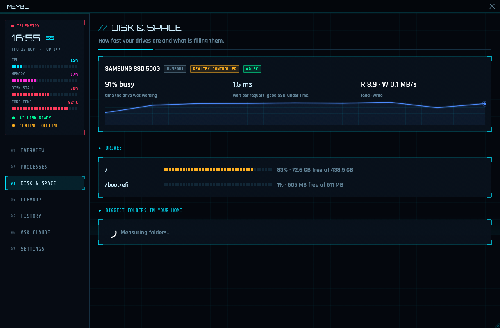
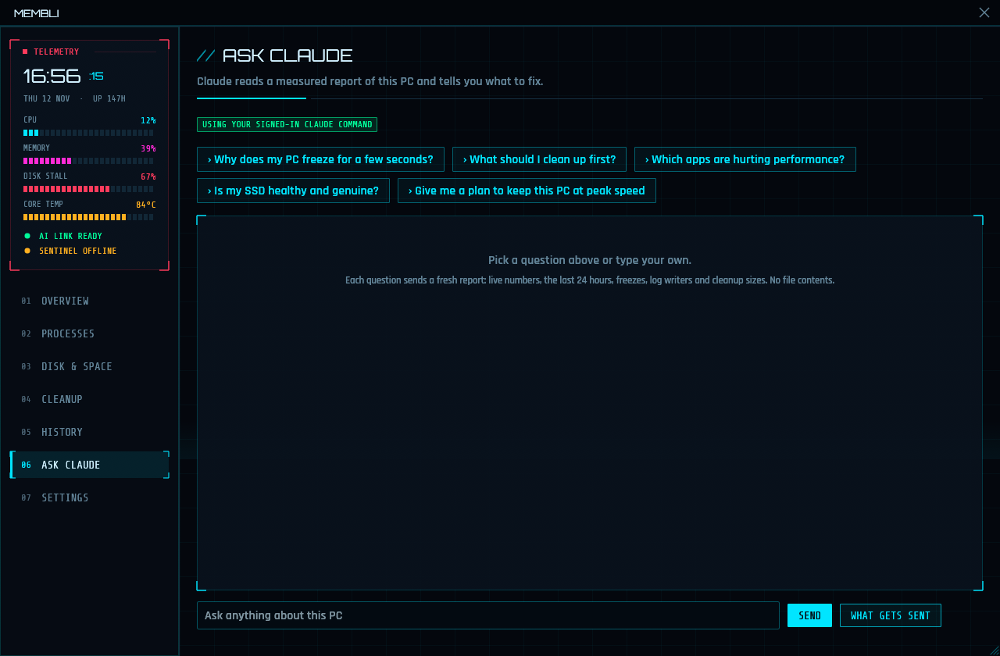
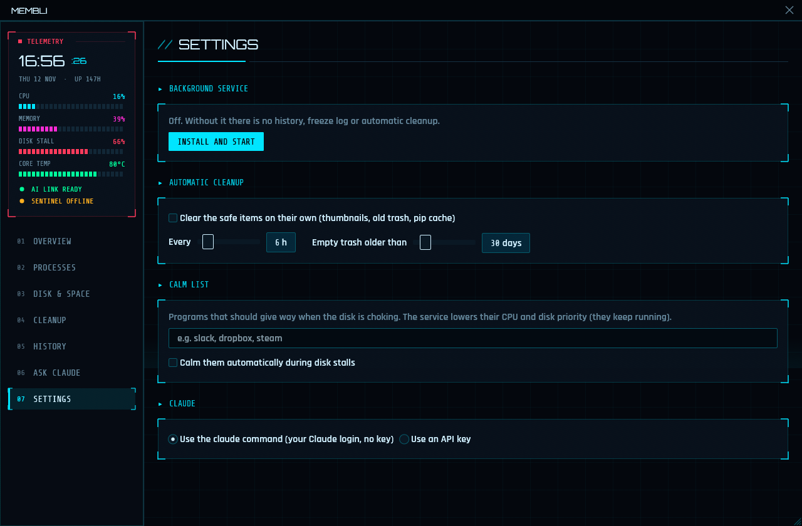

# Membli

**A sci-fi control center for your Ubuntu PC.** Membli watches everything that makes a Linux desktop feel slow: disk stalls, memory pressure, heat, runaway processes and log spam. It records every freeze with the programs that caused it, cleans up safely, and lets you fix problems with one click. It can also ask Claude to read a measured report of your machine and tell you what to do.

Written in Rust with [egui](https://github.com/emilk/egui). It reads everything from `/proc` and `/sys`, needs no root to run, and keeps itself at idle priority so the monitor never becomes the problem.


## Why

When a Linux desktop "freezes for a few seconds", the cause is usually not the CPU or RAM, and the usual monitors don't show it. Membli is built around **pressure stall information** (`/proc/pressure/*`): the kernel's own measure of how long programs were stuck waiting on the disk, memory or CPU. It turns that into plain findings such as *"The disk is holding everything up — programs spent 66% of the last 10 s waiting; stuck now: Apploye"* and puts a fix button next to each one.

## Features

### Overview, a live board
- **Integrity score**: one number for how healthy the machine is right now, shown on an animated ring.
- **Ticker tape** scrolling CPU, memory, disk stall, throughput, latency, swap, network, load, temperature and the busiest processes, each with its change.
- **Stat cards** with live charts and change markers against 10 seconds ago.
- **Core matrix**: every CPU core as a heat tile.
- **CPU candlesticks**: open/high/low/close per 5 seconds.
- **Top movers**: processes whose load changed most, flashing when they jump.
- **Threat assessment**: plain-language findings, each with one-click fixes.
- **Quick actions**: safe clean, TRIM, move swap back to RAM, shrink the system log, clear the browser cache, prune Docker, calm your background apps.
- **Freeze log** for the last 24 hours, and the programs flooding the system log.

### Processes
Every process with CPU, memory, disk read/write speed and swap. **Calm** lowers a program's CPU and disk priority without closing it (works on your own processes without a password). **End** asks it to close, after you confirm.


### Disk & Space
Each drive's model, **controller maker** (it catches rebadged drives, e.g. a "Samsung" label on a Realtek controller), temperature, busy %, latency and throughput, how full each filesystem is, and the biggest folders in your home.



### Cleanup
Three levels, so nothing surprising ever happens. Full rules in [docs/cleanup-safety.md](docs/cleanup-safety.md).

| Level | What | When it runs |
|---|---|---|
| **Safe** | picture thumbnails, trash older than 30 days, pip cache | on its own every few hours, if you turn Automatic cleanup on |
| **Your call** | browser caches (only while the browser is closed), npm / Yarn / Cargo caches, old `node_modules` and `target` folders in git projects untouched for 60 days, Docker build cache, unused Docker images and stopped containers | only when you click, after a confirmation |
| **System** | shrink the journal to 500 MB and cap it, old rotated logs, apt cache, old snap versions, TRIM, move swap back into RAM | only when you click; Ubuntu asks for your password each time |

Your documents, project source code and anything outside these folders are never touched.

### History
30 days of CPU, memory, disk stall and disk latency at 10-second resolution, plus a log of every freeze (with the programs behind it), calm and cleanup.


### Ask Claude
Membli builds a measured report of the machine: live numbers, the last 24 hours, recent freezes, log writers and cleanup sizes, with no file contents. *What gets sent* shows you the exact text. Claude answers with what to fix, and its suggestions come back as **buttons** limited to Membli's own safe actions (clean a listed item, calm or end a named process). Each goes through the same confirmation as everywhere else.

It works with the `claude` command you are already signed in to (no key needed) or with an Anthropic API key (default model `claude-opus-5-5`).



### Background service ("Sentinel")
A `systemd --user` service that samples every 2 seconds at idle priority, saves history, records each freeze with the programs behind it, calms the apps on your calm list while the disk is choking, and runs the Safe cleanup on a timer.



## Install

Requirements: Ubuntu 22.04 or newer (any Linux with cgroup v2 and PSI should work), a Rust toolchain (`rustup`), and an X11 or Wayland desktop.

```sh
git clone https://github.com/Btocode/membli.git
cd membli
cargo build --release
install -Dm755 target/release/membli ~/.local/bin/membli
~/.local/bin/membli install   # starts the background service and adds Membli to the app menu
```

Then open **Membli** from the app menu, or run `membli`.

To remove it:

```sh
systemctl --user disable --now membli.service
rm ~/.config/systemd/user/membli.service ~/.local/share/applications/membli.desktop ~/.local/bin/membli
rm -r ~/.config/membli ~/.local/share/membli   # settings and history
```

## Commands

```
membli            open the window
membli daemon     the background service (systemd runs this)
membli install    install the service and the app-menu entry
membli report     print the report Claude would get
membli clean      run the Safe cleanup once and print what it freed
```

## Files

| Path | What |
|---|---|
| `~/.config/membli/config.json` | settings (mode 0600, since it can hold an API key) |
| `~/.local/share/membli/history.db` | history, events and cleanup log (SQLite) |
| `~/.config/systemd/user/membli.service` | the background service |

## Window controls

Membli draws its own title bar. Drag it to move the window, double-click to maximize, press **F11** for full screen, and drag the corner grip to resize.

## How it works

[docs/architecture.md](docs/architecture.md) covers the modules, data sources, freeze detection, the action system and the Claude link.

## Credits

Ideas drawn from Mission Center and bottom (live views), BleachBit and Czkawka (cleanup), nohang and psimon (pressure-based detection), and Netdata (history).

Fonts: [Orbitron](https://fonts.google.com/specimen/Orbitron), [Rajdhani](https://fonts.google.com/specimen/Rajdhani) and [Share Tech Mono](https://fonts.google.com/specimen/Share+Tech+Mono), under the SIL Open Font License (`assets/fonts/OFL.txt`).

## License

MIT, see [LICENSE](LICENSE).
